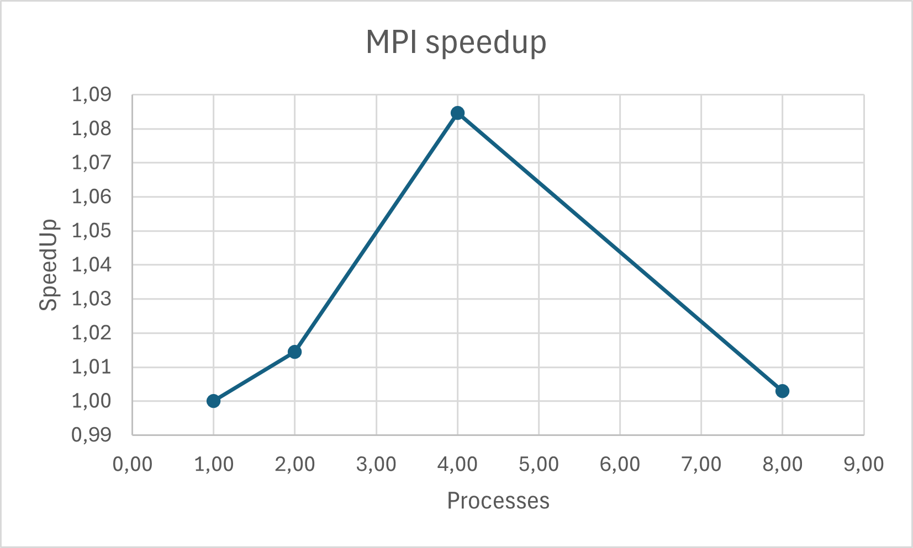
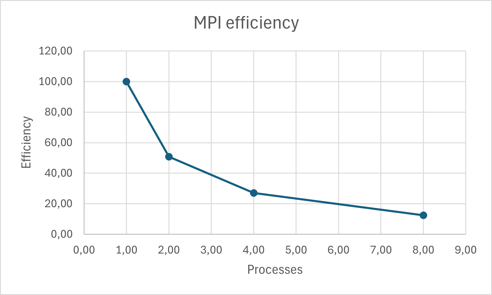

# Parallel Sparse Matrix-Vector Multiplication (SpMV)

**C++ | OpenMP | MPI | High-Performance Computing**

## Overview

This project implements and compares three approaches to Sparse Matrix-Vector Multiplication (SpMV):

1. Sequential implementation using C++.
2. Shared-memory parallelization using OpenMP.
3. Distributed-memory parallelization using MPI.

The objective is to evaluate correctness, execution time, speedup, efficiency, and scalability.

**Authors:** Madi Zhuptybay and Eraly  
**Course:** Parallelization of Algorithms  
**University:** Astana IT University

## 1. Mathematical Background

Sparse Matrix-Vector Multiplication computes:

\[y=Ax\]

where \(A\) is a sparse matrix, \(x\) is an input vector, and \(y\) is the resulting vector.

Sparse matrices contain many zero elements. Storing all these zeros wastes memory.

We use **Compressed Sparse Row (CSR)**, which represents the matrix using three arrays:

- `values`: nonzero matrix elements.
- `col_indices`: column indices of nonzero elements.
- `row_ptr`: starting offsets of each matrix row.

CSR reduces memory usage and allows efficient traversal of nonzero elements.

## 2. Implementations

### Sequential SpMV

The sequential implementation processes each matrix row and calculates the dot product using CSR data.

### OpenMP SpMV

OpenMP parallelizes the outer loop using:

```cpp
#pragma omp parallel for
```

Different threads process independent rows, writing their results to separate output positions.

### MPI SpMV

CSR blocks are distributed using MPI_Scatterv, while MPI_Gatherv collects the resulting vector.

The MPI implementation uses row-based data distribution.

- Process 0 generates the CSR matrix.
- The input vector is broadcast to all processes.
- CSR row blocks are distributed using MPI communication.
- Each process computes its local result.
- `MPI_Gatherv` collects the final result on process 0.

The root process retains the complete matrix, while worker processes receive their assigned CSR blocks.

## 3. Technologies

- C++
- OpenMP
- Microsoft MPI (MS-MPI)
- Visual Studio
- CSV and Excel for performance analysis

## 4. Experimental Setup

The main benchmark uses:

| Parameter | Value |
|---|---|
| Matrix dimensions | 100,000 × 100,000 |
| Nonzero elements per nonempty row | 100 |
| Storage format | CSR |
| Data type | double |
| OpenMP threads | 1, 2, 4, 8 |
| MPI processes | 1, 2, 4, 8 |
| Compiler configuration | Release x64 |

The generator uses deterministic nonzero values and includes empty rows.

Benchmark results were collected on a Windows machine using repeated measurements. OpenMP timings use the median of five runs, while MPI timings use the median of five separate executions.


## 5. Performance Results

### Experimental Setup

- Matrix size: 100,000 × 100,000
- Storage: CSR
- Up to 100 nonzero elements per nonempty row
- Every 10th row is empty
- Compiler: MSVC Release x64
- Repeated measurements using median execution time

### OpenMP Scalability

Speedup is measured relative to OpenMP with one thread.

| Threads | Time (s) | Speedup | Efficiency |
|---|---:|---:|---:|
| 1 | 0.019000 | 1.00x | 100.00% |
| 2 | 0.010085 | 1.88x | 94.20% |
| 4 | 0.007927 | 2.40x | 59.92% |
| 8 | 0.005864 | 3.24x | 40.50% |


#### OpenMP Performance Graphs


OpenMP scales to 3.24x on eight threads relative to its single-thread execution.

The separate sequential implementation showed different timings, which require further controlled investigation.

### MPI Scalability

MPI uses collective communication with MPI_Scatterv and MPI_Gatherv.

| Processes | Time (s) | Speedup | Efficiency |
|---|---:|---:|---:|
| 1 | 0.127326 | 1.000x | 100.00% |
| 2 | 0.125514 | 1.014x | 50.72% |
| 4 | 0.117389 | 1.085x | 27.12% |
| 8 | 0.126942 | 1.003x | 12.54% |


#### MPI Performance Graphs






MPI speedup is calculated relative to its one-process execution.

### Performance Analysis

OpenMP demonstrates useful thread-level scalability.

MPI shows limited end-to-end acceleration because data distribution and communication introduce substantial overhead.

The MPI_Scatterv implementation distributes CSR blocks collectively, but additional controlled comparisons are needed to quantify its improvement over MPI_Send.

Increasing the number of threads or processes does not guarantee proportional acceleration.

## 6. Correctness Testing

The project includes:

- A small matrix test with a known expected result.
- A completely zero matrix test.
- Comparisons between sequential and OpenMP outputs.
- Comparisons between sequential and MPI outputs.
- A test with uneven MPI row distribution.

All reported tests passed.

## 7. Build and Run

### Requirements

- Windows
- Visual Studio with C++ development tools
- MS-MPI Runtime
- MS-MPI SDK
- OpenMP support enabled

### Build

Open the Visual Studio project and select:

`Release | x64`

Enable OpenMP using `/openmp`.

Configure the MS-MPI include directory, library directory, and `msmpi.lib` dependency.

Build the solution.

### Run

Open a terminal in the directory containing `ParallelSpMV.exe`.

Execute the program with four MPI processes:

```cmd
mpiexec -n 4 ParallelSpMV.exe
```

For other process counts:

```cmd
mpiexec -n 1 ParallelSpMV.exe
mpiexec -n 2 ParallelSpMV.exe
mpiexec -n 8 ParallelSpMV.exe
```

The program displays execution time and correctness results.

## 8. Limitations and Future Improvements

Potential improvements include:

- Testing additional matrix sizes and sparsity patterns.
- Improving workload balance across processes.
- Reducing MPI communication overhead.
- Exploring alternative OpenMP scheduling strategies.
- Automating benchmarks and reproducibility checks.
- Comparing performance on different hardware configurations.

## Conclusion

This project demonstrates how the same mathematical operation can be implemented using sequential, shared-memory, and distributed-memory programming.

The experiments highlight the importance of correctness testing, memory-efficient data structures, communication overhead, and careful performance analysis.

The results provide a foundation for further work in High-Performance Computing and Scientific Computing.
